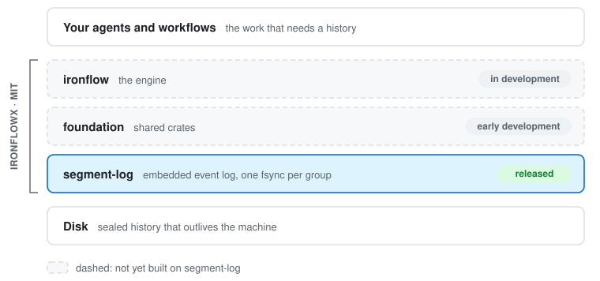

# Ironflow

Agents and workflows need history that survives crashes, retries and short-lived machines. Ironflowx builds that layer in Rust: open, MIT-licensed, and usable piece by piece.

It is inspired by [Ironflow](https://ironflow.run). Ironflow 1.x, the shipping product, stays under the Ironflow License.

**Original author and architect of both projects:** [Altug Sahin](https://github.com/sahina)

| Project | What it is | Status |
| --- | --- | --- |
| [segment-log](https://github.com/ironflowx/segment-log) | Embedded append-only event log. Group commit: one fsync per batch of appends. Per-stream revisions, idempotency keys, seal. |  |
| [ironflow](https://github.com/ironflowx/ironflow) | Ironflow engine | In development |
| [foundation](https://github.com/ironflowx/foundation) | Shared foundation crates |  |

All projects are MIT licensed. Issues and PRs welcome: see the [contributing guide](https://github.com/ironflowx/.github/blob/main/CONTRIBUTING.md). Report security problems privately as described in the [security policy](https://github.com/ironflowx/.github/blob/main/SECURITY.md).
